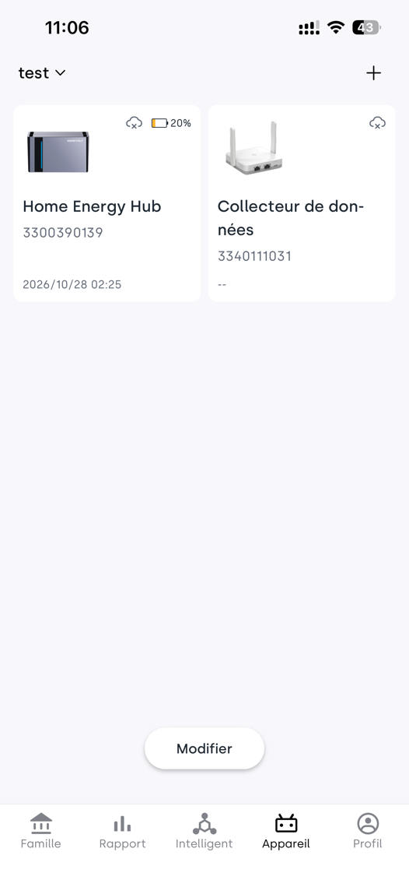
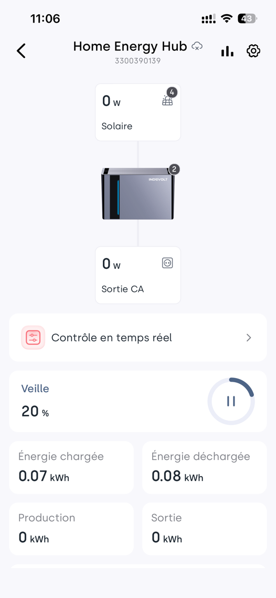
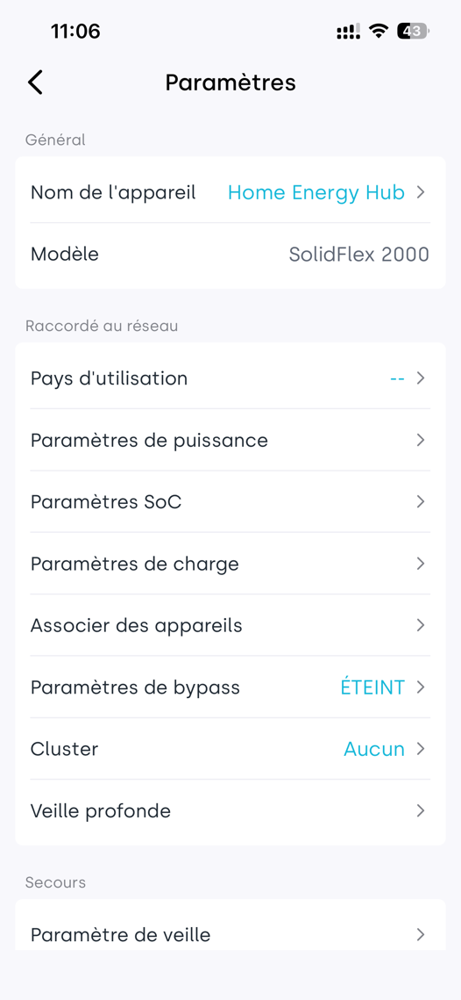
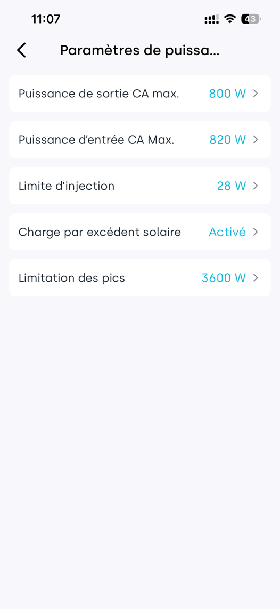
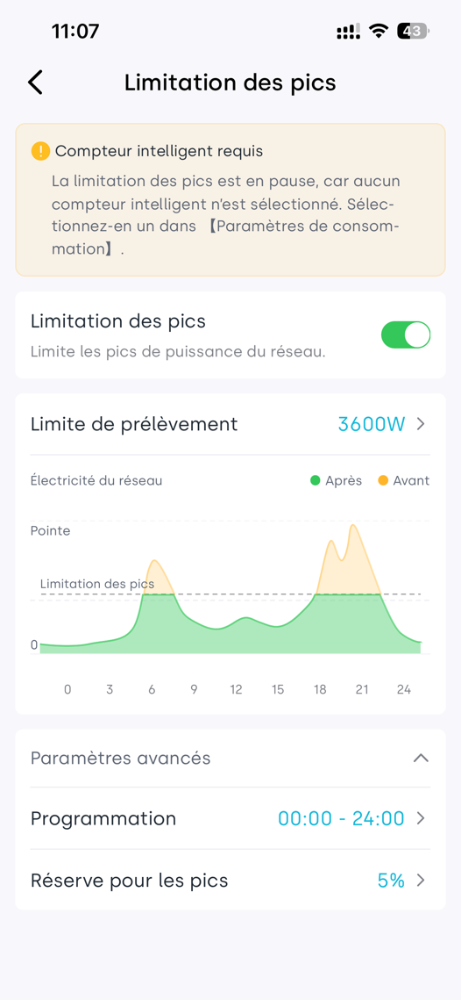
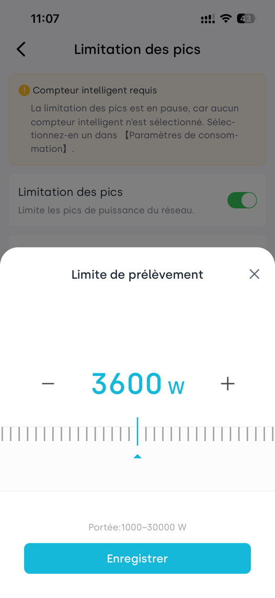
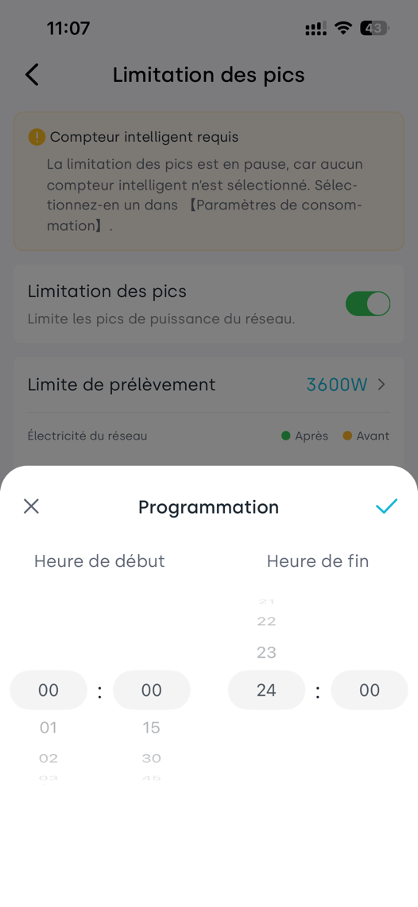
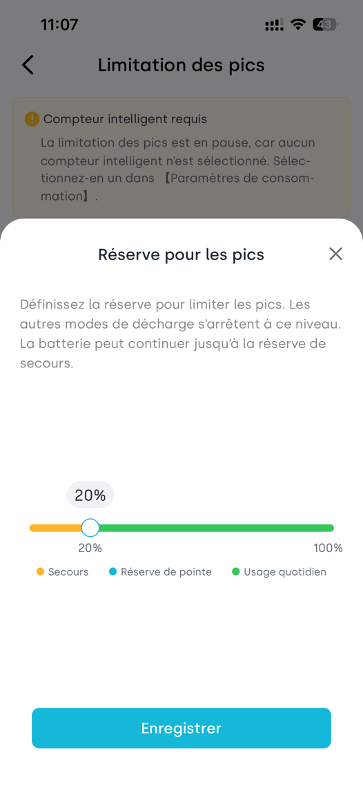

# Guide d’utilisation de la limitation des pics
Comprendre comment la batterie réserve de l’énergie et réduit le prélèvement sur le réseau pendant les pics de consommation.
---
## 1. Ce que la limitation des pics peut vous apporter
Quand plusieurs appareils fonctionnent en même temps, la puissance prélevée sur le réseau peut augmenter brusquement. Lorsque la limitation des pics est activée, la batterie fournit de l’énergie complémentaire quand les conditions de déclenchement sont atteintes, afin de maintenir la puissance de prélèvement réseau aussi proche que possible de la valeur cible définie.

### Pourquoi s’intéresser aux frais de puissance‑pic
Dans certaines régions ou certains abonnements tarifaires, en plus des frais liés à la quantité d’énergie consommée, des frais sont facturés selon la puissance‑pic. La consommation correspond à la quantité totale d’énergie sur une période, unité kWh (aussi appelée degré). La puissance‑pic correspond au niveau de puissance moyenne sur un intervalle de mesure, unité kW.

Pour certains tarifs, les frais de puissance‑pic sont calculés à partir de la puissance moyenne maximale sur 15 minutes au cours d’un mois. Même un seul pic de consommation peut augmenter vos frais mensuels. En faisant fournir une partie de la charge de pointe par la batterie, vous pouvez abaisser la puissance‑pic prise en compte pour la facturation. Les intervalles de mesure, plages tarifaires et modalités de calcul dépendent de votre contrat d’électricité.

La seconde partie de ce guide présente l’exemple de la Flandre belge : comment réduire la redevance de capacité grâce à l’écrêtage des pics, avec des exemples de calcul basés sur les tarifs d’Anvers pour l’année 2026.

### Règles principales
La limitation des pics a une priorité supérieure aux modes de fonctionnement comme l’autoconsommation. Même si le SOC de la batterie est supérieur au SOC de réserve pour pics, le système interrompt le mode en cours et exécute en priorité l’écrêtage des pics dès que les conditions de déclenchement sont remplies.
Lorsque le niveau d’énergie descend en dessous du SOC de réserve pour pics, les autres modes de décharge s’arrêtent. Seule la limitation des pics continue de décharger la batterie jusqu’au SOC de secours.

Le SOC correspond au pourcentage d’énergie restante dans la batterie. Un SOC de 30 % signifie qu’il reste environ 30 % de la capacité de la batterie. Le SOC de réserve pour pics est un seuil de réserve d’énergie, **pas** une limite supérieure de puissance consommée.
---
## 2. Influence de la réserve d’énergie sur l’autoconsommation
Le SOC de réserve pour pics est le seuil de mise en réserve, **pas** le seuil de démarrage de la limitation des pics. La limitation des pics peut démarrer même au‑dessus de cette valeur. Le SOC de secours est la limite basse pour tous les déchargements.

| Paramètre | Rôle |
|---|---|
| SOC réserve pour pics | À ce niveau, les autres modes arrêtent de décharger la batterie. L’énergie est réservée pour la limitation des pics. Dans l’application : *Réserve pour les pics*, valeur par défaut 5 %. |
| SOC de secours | Quand la batterie atteint ou descend en dessous de ce niveau, la limitation des pics arrête toute décharge, même si la puissance consommée reste élevée. |

### Exemple : SOC réserve pour pics = 30 %, SOC secours = 10 %
| État de la batterie | Décharge pour autoconsommation | Décharge pour limitation des pics |
|---|---|---|
| 50 %, hors état de réserve | Sans demande de pic, le mode initial fonctionne | Au déclenchement, le mode est suspendu, l’écrêtage des pics est prioritaire |
| Descendu à ≤30 % et >10 % | Arrêt, énergie réservée aux pics | S’exécute si les conditions de déclenchement sont remplies |
| ≤10 % | Arrêt | Arrêt, pas de décharge même en cas de surpuissance |
| Rechargé à 32 % après mise en réserve | Retour au mode initial | S’exécute si les conditions de déclenchement sont remplies |

#### Exemple 1 : batterie à 25 %, pourquoi pas de décharge autoconsommation
Le soir, les appareils consomment au total 2 kW, pas de production solaire, SOC batterie 25 %.
La batterie est dans la plage de réserve. L’autoconsommation ne déclenche plus de décharge ; le manque d’énergie est compensé par le réseau. L’énergie réservée est conservée pour d’éventuels pics de consommation futurs.

#### Exemple 2 : toujours 25 %, pourquoi la décharge démarre
Puis la consommation augmente, le prélèvement réseau atteint 4,5 kW. La puissance de limitation est réglée à 3,6 kW. Si le prélèvement réseau reste ≥3,6 kW pendant 5 secondes, la limitation des pics démarre et la batterie fournit de la puissance complémentaire. L’objectif de prélèvement réseau est 3,4 kW, la batterie doit fournir environ 1,1 kW. Les pertes sont ignorées, on suppose que la batterie dispose d’une puissance de décharge suffisante.

#### Exemple 3 : rechargé à 31 %, le mode n’est pas restauré
Après l’entrée en état de réserve, le mode initial ne reprend pas immédiatement quand le SOC dépasse 30 %. Il faut atteindre **32 % (30 % + 2 points de pourcentage)**. Cela évite des basculements fréquents dus à de petites fluctuations autour du seuil.

> **Ne pas conserver de réserve supplémentaire :** Réglez le SOC réserve pour pics à la même valeur que le SOC de secours. Il n’y aura plus de plage de réserve dédiée. Au‑dessus du SOC de secours, le système répond toujours aux demandes de pic et réalise l’écrêtage en priorité. La valeur ne peut pas être inférieure à la réserve de secours. Dans l’application, la réserve de secours est la valeur minimale autorisée : mettez‑les simplement identiques.
---
## 3. Quand démarre et s’arrête la limitation des pics
Exemple de réglage de puissance de limitation : 3600 W (3,6 kW). C’est la valeur par défaut, modifiable. Le système surveille la **puissance prélevée sur le réseau**, pas la somme des puissances de tous les appareils domestiques.

| Phase | Comportement observé |
|---|---|
| Démarrage | Prélèvement réseau ≥3600 W pendant au moins 5 secondes, SOC batterie > SOC secours → la batterie commence la limitation des pics |
| Objectif de régulation | La batterie fournit de la puissance complémentaire pour ramener le prélèvement réseau à 3400 W (valeur réglée moins 200 W) |
| Régulation continue | Si le prélèvement réseau descend en dessous de 3600 W après le démarrage, la régulation ne s’arrête pas immédiatement. Elle reste active entre 3100 W et 3600 W. |
| Fin de régulation | La limitation s’arrête si prélèvement réseau &lt;3100 W pendant 30 secondes **ou** prélèvement réseau &lt;400 W. Si &lt;400 W, le délai de 30 secondes ne s’applique pas. |

### Seuils différents pour démarrage et arrêt
Si la fonction démarre aussitôt au‑dessus de 3600 W et s’arrête aussitôt en dessous, de petites variations de puissance provoquent des basculements répétés. Des seuils distincts assurent un fonctionnement plus stable.

### Comportement après la fin de la limitation
Quand la limitation des pics s’active, les modes comme autoconsommation, contrôle en temps réel ou programmation horaire sont suspendus, l’écrêtage des pics est prioritaire. À la fin de la limitation, le mode précédent est restauré.
Si la batterie est toujours dans la plage de réserve, les autres modes de décharge restent désactivés. La restauration n’intervient qu’après recharge jusqu’à *SOC réserve pour pics + 2 points de pourcentage*.

### Pas de garantie d’absence de dépassement
La limitation des pics **ne garantit pas** que le prélèvement réseau ne dépassera jamais la valeur réglée. Des conditions temporelles s’appliquent au déclenchement ; le résultat dépend aussi du niveau de charge de la batterie, de sa puissance maximale de décharge et de l’état de l’équipement. Quand la batterie atteint le SOC de secours, la limitation s’arrête. Si la consommation reste élevée, le prélèvement sur le réseau peut dépasser le seuil configuré.

Les temps de déclenchement et d’arrêt de l’appareil sont des règles de pilotage technique. Les intervalles de mesure du gestionnaire de réseau sont les règles de facturation. Il ne faut pas les confondre : le déclenchement à 5 secondes de l’appareil **n’est pas** l’intervalle de mesure utilisé pour la facturation.
---
## 4. Vérifier le compteur intelligent avant configuration
Vérifiez que l’équipement est connecté à un compteur intelligent compatible et qu’il peut lire la puissance de prélèvement réseau.
Message dans l’application : si aucun compteur intelligent n’est sélectionné, la limitation des pics est mise en pause. Sélectionnez le compteur dans **Paramètres de consommation**, la fonction s’active automatiquement.

Chemin : Appareil → équipement de stockage micro‑réseau sélectionné → icône engrenage en haut à droite → **Paramètres de consommation** → sélectionner le compteur intelligent. Retournez ensuite sur la page limitation des pics et vérifiez que le message de pause a disparu. La page de sélection du compteur n’apparaît pas sur les captures, les options réelles dépendent de votre version d’application.

### Étape 1: Accéder à la page appareil
Appuyez sur **Appareil** en bas de l’application, puis appuyez sur la carte de votre équipement de stockage micro‑réseau, par exemple « Home Energy Hub ».

### Étape 2: Ouvrir les paramètres de l’appareil
Appuyez sur l’icône engrenage située en haut à droite de la page détail appareil.

Gauche : Liste des appareils. Droite : Page détail appareil, icône engrenage en haut à droite. Nom de l’appareil et valeurs affichées sont uniquement des exemples d’interface.

---
## 5. Trouver et activer la limitation des pics
### Étape 3: Ouvrir les paramètres de puissance
Sur la page paramètres de l’appareil, appuyez sur **Paramètres de puissance**. Si aucun compteur intelligent n’est encore sélectionné, faites‑le d’abord dans *Paramètres de consommation* sur cette même page.

### Étape 4: Accéder à la limitation des pics
Dans *Paramètres de puissance*, appuyez sur **Limitation des pics**. Le titre de la page est « Limitation des pics ». Activez l’interrupteur de limitation des pics.

Gauche : Page paramètres généraux avec *Paramètres de puissance* et *Paramètres de consommation*. Droite : Page paramètres de puissance, appuyez sur *Limitation des pics* pour ouvrir.

---
## 6. Configurer la puissance d’écrêtage
### Étape 5: Régler la puissance de prélèvement réseau souhaitée
Sur la page *Limitation des pics*, appuyez sur **Limite de prélèvement**. Ajustez la valeur dans la fenêtre pop‑up puis enregistrez. Plage de réglage : 1000‑30000 W, valeur par défaut 3600 W. C’est la plage paramétrable, l’effet réel reste limité par la puissance de décharge maximale de l’appareil.

Exemple : réglage à 3600 W : déclenchement quand prélèvement ≥3600 W pendant 5 s, objectif de prélèvement réseau environ 3400 W.
Adaptez cette valeur à vos pics historiques, votre profil de charge et les capacités de la batterie. Ne reprenez pas aveuglément la valeur par défaut pour tous les foyers.

Gauche : Page principale limitation des pics. Droite : Fenêtre pop‑up réglage puissance, ajuster puis enregistrer en bas. Le bandeau jaune en haut indique qu’aucun compteur intelligent n’est sélectionné. Un interrupteur activé ne signifie **pas** que la fonction est opérationnelle.

---
## 7. Régler programmation et réserve pour les pics
### Étape 6: Définir la programmation
Déployez *Paramètres avancés*, appuyez sur **Programmation**. Définissez heure de début et heure de fin, confirmez avec la coche en haut à droite. 00:00‑24:00 signifie fonctionnement 24h/24.
Pour la redevance de capacité flamande, un pic mensuel peut survenir à n’importe quel moment. Une couverture 24h évite des pics non détectés, à condition que la batterie dispose d’énergie disponible suffisante.

### Étape 7: Régler la réserve pour les pics
Appuyez sur **Réserve pour les pics**, déplacez le curseur puis enregistrez. Ce paramètre correspond au SOC réserve pour pics. La valeur minimale est la réserve de secours, maximum 100 %.
Exemple : réserve pour pics 30 %, réserve de secours 10 % : l’énergie comprise entre ces deux valeurs est réservée pour la limitation des pics.
Si vous ne voulez pas de réserve supplémentaire : réglez ce paramètre identique à la réserve de secours.

Gauche : Fenêtre pop‑up programmation. Droite : Fenêtre pop‑up réserve pour les pics. Après enregistrement revenez sur la page principale, vérifiez : état de l’interrupteur, puissance de limitation, programmation, réserve pour pics et que l’avertissement sur compteur intelligent a disparu.

> **Méthode de validation :**
> Au‑dessus du SOC réserve pour pics : quand les conditions de déclenchement sont remplies, le mode actif est suspendu pour l’écrêtage des pics
> Dans la plage de réserve : sans demande de pic, les autres modes ne déchargent pas ; la limitation des pics fonctionne jusqu’au SOC de secours
> Le mode initial n’est restauré qu’après recharge jusqu’à *SOC réserve pour pics + 2 points de pourcentage*.
---
## 8. Comment les foyers belges réduisent leurs frais avec l’écrêtage des pics
### Valable pour les foyers de Flandre équipés d’un compteur numérique intelligent
Les règles tarifaires diffèrent selon les régions belges. Cet exemple porte sur la **redevance de capacité (capaciteitstarief)** de Flandre. C’est une composante des frais de réseau, pas une amende pour dépassement d’une puissance fixe ; ce n’est pas non plus la totalité de la facture d’électricité.

Le compteur numérique enregistre la consommation toutes les 15 minutes et calcule la puissance moyenne prélevée. Chaque mois, la valeur maximale est retenue comme pic mensuel. Le pic mensuel moyen correspond à la moyenne des 12 derniers pics mensuels. Le pic final pris en compte pour la facture est calculé avec une pondération sur la période de règlement.
Il existe un seuil minimal de facturation de 2,5 kW. Descendre en dessous ne réduit plus cette composante tarifaire.

### Exemple de foyer et paramètres
Foyer d’Anvers, pas de production solaire le soir, plusieurs appareils fonctionnent simultanément. Sans limitation des pics, la puissance moyenne prélevée sur le réseau sur un intervalle de 15 minutes est de 6,0 kW. La batterie dispose de puissance et d’énergie suffisantes.
Paramètres du foyer : puissance de limitation 3600 W, programmation 00:00‑24:00, réserve pour les pics 30 %, réserve de secours 10 %. Ce sont des valeurs d’exemple, pas une recommandation universelle.

Pendant la limitation, l’objectif de prélèvement réseau est d’environ 3,4 kW. Pour une charge domestique de 6,0 kW, la batterie doit fournir environ 2,6 kW. Fournir cette puissance pendant 15 minutes consomme environ 0,65 kWh (hors pertes). La batterie doit disposer à la fois d’une puissance de décharge et d’une quantité d’énergie suffisantes.

Pour une capacité nominale de batterie de 5 kWh, la plage 30 %‑10 % correspond à environ 1 kWh d’énergie nominale réservée. L’énergie réellement disponible dépend des pertes, de la température et de l’état de la batterie. Si plusieurs pics surviennent au cours d’une même journée, l’énergie réservée peut être épuisée.

### Pourquoi l’exemple calcule avec 3,6 kW
La valeur cible de régulation 3,4 kW n’est pas identique à la mesure sur 15 minutes du compteur du gestionnaire de réseau. Compte tenu du déclenchement à 5 secondes et des fluctuations de puissance, l’exemple retient un pic mensuel mesuré réel de 3,6 kW, au lieu d’utiliser directement 3,4 kW comme valeur de facturation. On suppose qu’aucun pic plus élevé n’apparaît sur le reste du mois.

Si un pic de 6,0 kW a déjà été enregistré dans le mois, activer la fonction ne supprime pas cet historique. Elle évite seulement de nouveaux pics plus élevés et fait baisser les pics des mois suivants. Si la batterie se vide pendant un pic, un nouveau pic mensuel élevé peut apparaître.
---
## 9. Calcul des économies pour l’exemple belge
### Tarifs officiels Fluvius Anvers 2026 basse tension avec mesure de pic.
La redevance de capacité sur le pic mensuel moyen est de **49,4036563 EUR/kW/an (hors TVA)**. L’exemple utilise 49,40 EUR/kW/an. Ce tarif ne s’applique qu’à cette région et cette année ; pour d’autres régions reportez‑vous à votre facture ou aux documents tarifaires officiels.

Hypothèse : les pics mensuels historiques et toute la période de règlement sont stabilisés aux niveaux respectifs. Les pics facturés sont respectivement 6,0 kW et 3,6 kW. Le premier mois après activation
