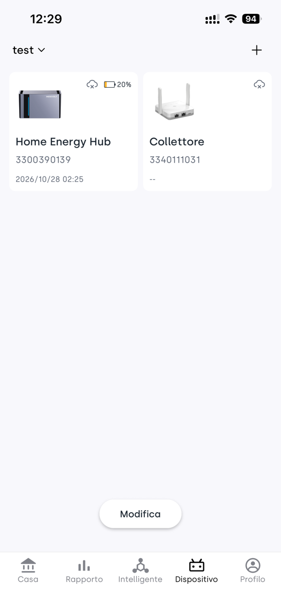
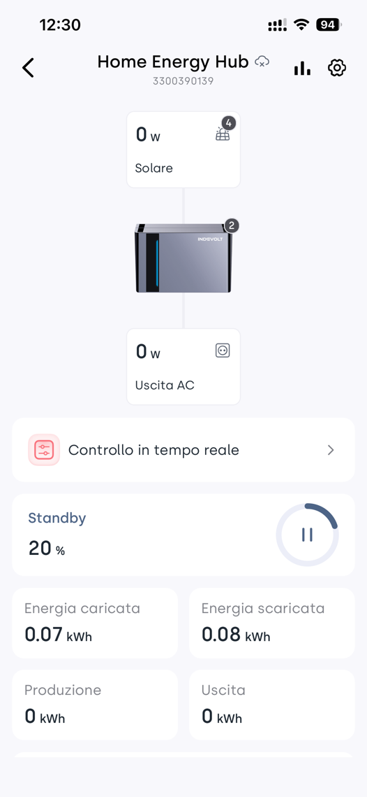
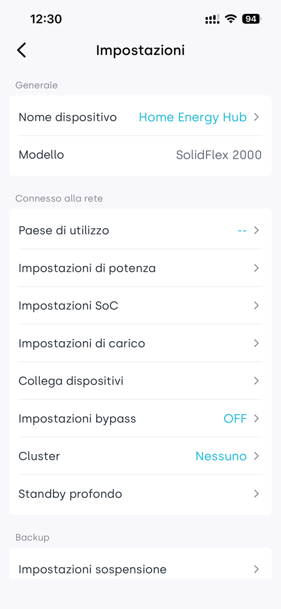
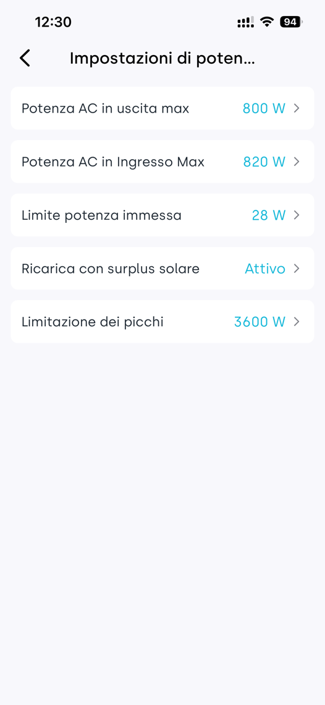
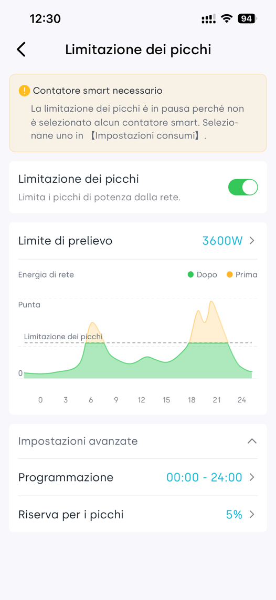
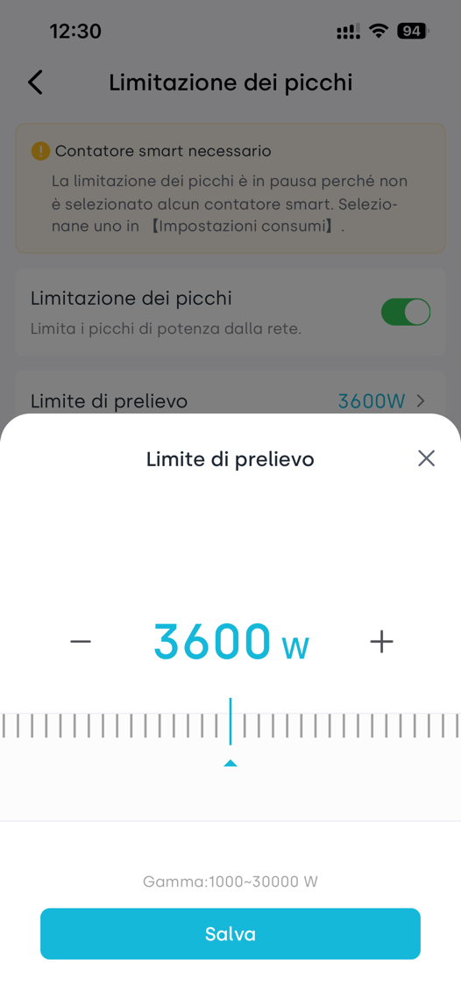
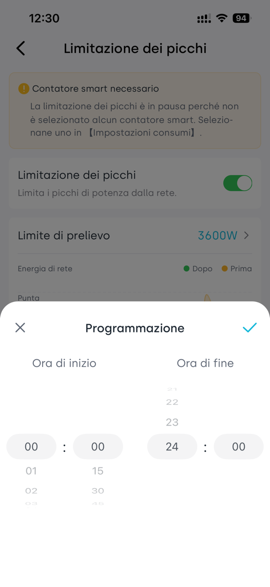
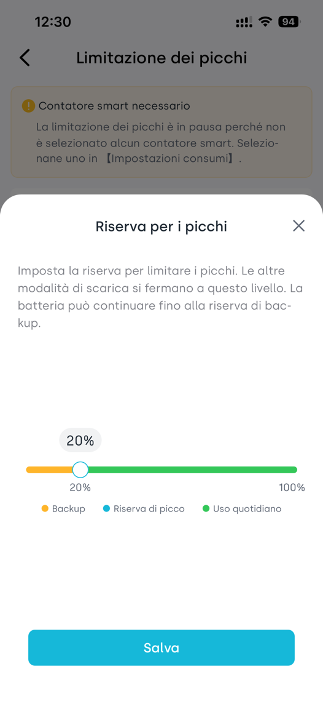

# Handleiding pieklastbegrenzing
Leer hoe de batterij capaciteit reserveert en het netverbruik verlaagt tijdens piekuren.
---
## 1. Wat pieklastbegrenzing voor u kan doen
Wanneer meerdere apparaten tegelijkertijd werken, kan het vermogen dat u van het net afneemt plotseling toenemen. Wanneer pieklastbegrenzing is ingeschakeld, levert de batterij bij geactiveerde voorwaarden extra vermogen, om het netafnamevermogen zo dicht mogelijk bij de ingestelde doelwaarde te houden.

### Waarom u aandacht moet besteden aan pieklasttarieven
Bij sommige regio’s of tariefpakketten wordt er naast verbruikskosten ook een pieklasttarief in rekening gebracht. Het energieverbruik geeft aan hoeveel energie er in een periode is verbruikt, eenheid kWh (ook wel graad). De pieklast geeft het gemiddelde vermogen binnen een meetperiode aan, eenheid kW.

Bij bepaalde tarieven wordt de pieklasttarief berekend op basis van het hoogste gemiddelde vermogen over 15 minuten binnen een maand. Zelfs éénmalige piek kan de maandelijkse kosten beïnvloeden. Door een deel van het piekverbruik door de batterij te laten leveren, kan de gefactureerde pieklast worden verlaagd. De daadwerkelijke meetperiode, tariefperiode en berekeningswijze zijn afhankelijk van uw energiecontract.

In het tweede deel van deze handleiding wordt aan de hand van een voorbeeld uit de Vlaamse regio in België uitgelegd hoe u met de batterij pieken kunt afvlakken om de capaciteitsvergoeding te verlagen, inclusief berekeningsvoorbeelden voor de tarieven van 2026 in Antwerpen.

### Kernregels
Pieklastbegrenzing heeft hogere prioriteit dan de huidige bedrijfsmode zoals zelf‑verbruik. Zelfs als de batterij‑SOC hoger is dan de pieklast‑SOC, onderbreekt het systeem de huidige modus en voert eerst de piekafvlakking uit zodra de trigger‑voorwaarden zijn vervuld.
Zodra het energieniveau onder de pieklast‑SOC zakt, stoppen andere bedrijfsmodi met ontladen. Alleen pieklastbegrenzing blijft ontladen tot de back‑up‑SOC.

SOC is het percentage resterende batterijcapaciteit. Een SOC van 30% betekent dat er ongeveer 30% van de batterij‑energie over is. De pieklast‑SOC is de drempel voor gereserveerde energie, geen bovengrens voor het verbruiksvermogen.
---
## 2. Invloed van gereserveerde energie op zelf‑verbruik
De pieklast‑SOC is de drempel voor reservering, **niet** de startdrempel voor pieklastbegrenzing. De piekbegrenzing kan ook al boven deze waarde starten. De back‑up‑SOC is de ondergrens voor alle ontlaadhandelingen.

| Instelling | Werking |
|---|---|
| Pieklast‑SOC | Bij deze waarde stoppen andere modi met batterij‑ontladen. De energie wordt gereserveerd voor pieklastbegrenzing. In de App weergegeven als *Reserve voor pieklasten*, standaard 5%. |
| Back‑up‑SOC | Wanneer de batterij deze waarde bereikt of lager komt, stopt pieklastbegrenzing met ontladen, ook als het verbruiksvermogen te hoog is. |

### Voorbeeld: pieklast‑SOC = 30 %, back‑up‑SOC =10 %
| Batterijniveau en toestand | Ontladen voor zelf‑verbruik | Ontladen voor pieklastbegrenzing |
|---|---|---|
| 50%, geen reserveringsstatus | Zonder piekverzoek werkt de oorspronkelijke modus | Bij trigger wordt de modus onderbroken, piekafvlakking heeft voorrang |
| Gedaald naar ≤30% en >10% | Gestopt, energie gereserveerd voor pieklasten | Wordt uitgevoerd indien trigger‑voorwaarden gelden |
| ≤10% | Gestopt | Gestopt; geen ontladen ook bij te hoog vermogen |
| Opgeladen tot 32% na reservering | Oorspronkelijke modus hersteld | Wordt uitgevoerd indien trigger‑voorwaarden gelden |

#### Voorbeeld 1: batterij 25%, waarom geen zelf‑verbruik‑ontladen
‘s Avonds verbruiken apparaten samen 2 kW, er is geen opwekking van zonne‑energie, batterij‑SOC 25%.
De batterij bevindt zich binnen het gereserveerde bereik, dus zelf‑verbruik ontlaadt niet meer. Het tekort wordt aangevuld door het net. De gereserveerde energie wordt bewaard voor mogelijke toekomstige verbruikspieken.

#### Voorbeeld 2: nog steeds 25%, waarom wordt er nu wel ontladen
Vervolgens stijgt het verbruik, het netafnamevermogen bereikt 4,5 kW. De ingestelde begrenzingswaarde is 3,6 kW. Wanneer het netafnamevermogen ≥3,6 kW blijft gedurende 5 seconden, start pieklastbegrenzing en levert de batterij extra vermogen. Doelnetafname is 3,4 kW, de batterij moet ca. 1,1 kW leveren. Verliezen worden genegeerd, er wordt uitgegaan van voldoende batterij‑ontlaadvermogen.

#### Voorbeeld3: opgeladen naar 31%, nog geen herstel
Na de reserveringsstatus wordt de oude modus niet direct hersteld zodra de SOC boven 30% komt. Er moet worden opgeladen tot **32% (30% + 2 procentpunten)**. Dit voorkomt herhaald schakelen door kleine schommelingen rond de drempelwaarde.

> **Geen aparte reservering gewenst:** Stel de pieklast‑SOC gelijk aan de back‑up‑SOC. Dan is er geen extra gereserveerd bereik. Boven de back‑up‑SOC reageert het systeem nog steeds op piekverzoeken en voert piekafvlakking met voorrang uit. De waarde kan niet lager worden ingesteld dan de back‑up‑SOC. In de App is de back‑up‑reserve de minimale instelwaarde: stel beide gewoon op dezelfde waarde.
---
## 3. Wanneer start en stopt pieklastbegrenzing
Voorbeeld‑instelling begrenzingsvermogen: 3600 W (3,6 kW). Dit is de standaardwaarde en kan worden aangepast. Het systeem observeert het **van het net afgenomen vermogen**, niet het totaalvermogen van alle huishoudelijke apparaten.

| Fase | Gedrag |
|---|---|
| Start | Netafnamevermogen ≥3600 W gedurende minimaal 5 seconden, batterij‑SOC > back‑up‑SOC → batterij start met pieklastbegrenzing |
| Streefwaarde | De batterij levert extra vermogen om het netafnamevermogen te verlagen naar 3400 W (ingestelde waarde min 200 W) |
| Doorlopende regeling | Wanneer het netafnamevermogen na start onder 3600 W komt, stopt de regeling niet direct. Bij vermogen tussen 3100‑3600 W blijft de regeling actief. |
| Uitschakelen | Regeling wordt beëindigd wanneer netafnamevermogen &lt;3100 W gedurende 30 seconden **of** netafnamevermogen &lt;400 W. Bij &lt;400 W geldt geen wachttijd van 30 seconden. |

### Verschillende drempels voor start en einde
Als de regeling onmiddellijk start boven 3600 W en direct stopt onder 3600 W, veroorzaken kleine vermogensschommelingen constant schakelen. Verschillende drempels zorgen voor stabielere werking.

### Gedrag na afloop van de begrenzing
Wanneer pieklastbegrenzing wordt geactiveerd worden de modi zoals zelf‑verbruik, realtime‑regeling of tijdregeling onderbroken, piekafvlakking heeft voorrang. Na afloop van de begrenzing wordt de vorige modus hersteld.
Indien de batterij zich nog in het reserveringsbereik bevindt, blijven andere ontlaadmodi uitgeschakeld. Herstel vindt pas plaats na opladen tot *pieklast‑SOC + 2 procentpunten*.

### Geen absolute garantie tegen overschrijding
Pieklastbegrenzing **garandeert niet** dat de netafname nooit de ingestelde waarde overschrijdt. Voor het starten gelden tijdsvoorwaarden; het resultaat hangt ook af van batterijniveau, maximaal ontlaadvermogen en toestand van het apparaat. Zodra de batterij de back‑up‑SOC bereikt, stopt de piekregeling. Bij hoog blijvend verbruik kan het netafnamevermogen de ingestelde grens overschrijden.

De trigger‑ en uitschakeltijden van het apparaat zijn bedrijfsregels voor de besturing. De meetperiodes van de energieleverancier zijn de factureringsregels. Deze twee mogen niet met elkaar worden verward: de 5‑seconden‑trigger van het apparaat is **niet** de factureringsmeetperiode.
---
## 4. Controleer eerst de slimme meter voor de instelling
Zorg ervoor dat het apparaat verbonden is met een compatibele slimme meter en het netafnamevermogen kan uitlezen.
App‑melding: wanneer er geen slimme meter geselecteerd is, wordt pieklastbegrenzing gepauzeerd. Selecteer de meter onder **Belastinginstellingen**, dan wordt de functie automatisch geactiveerd.

Pad: Apparaat → geselecteerd micro‑opslagapparaat → tandwiel‑icoon rechtsboven → **Belastinginstellingen** → selecteer de slimme meter. Ga daarna terug naar de pieklast‑pagina en controleer of de pauze‑melding verdwenen is. De selectiepagina voor de meter is niet getoond op de schermafbeeldingen, de werkelijke opties hangen af van uw App‑versie.

### Stap 1: Ga naar de apparaatpagina
Tik onderaan de App op **Apparaat**, tik vervolgens op de kaart van uw micro‑opslagapparaat, bijvoorbeeld “Thuisbatterij”.

### Stap 2: Open apparaatinstellingen
Tik op het tandwiel‑icoon rechtsboven op de apparaatdetailpagina.

Links: Apparaatlijst. Rechts: Apparaatdetailpagina, tandwiel‑icoon staat rechtsboven. Apparaatnaam en getoonde waarden zijn slechts voorbeelden van de interface.

---
## 5. Vind en activeer pieklastbegrenzing
### Stap3: Open vermogeninstellingen
Tik op de pagina Apparaatinstellingen op **Vermogeninstellingen**. Als nog geen slimme meter geselecteerd is, doe dit eerst onder *Belastinginstellingen* op dezelfde pagina.

### Stap4: Open pieklastbegrenzing
Tik binnen *Vermogeninstellingen* op **Pieklastbegrenzing**. De paginatitel wordt *Pieklastbegrenzing*. Schakel de schakelaar voor pieklastbegrenzing in.

Links: Instellingspagina met *Vermogeninstellingen* en *Belastinginstellingen*. Rechts: Vermogeninstellingen‑pagina, tik op *Pieklastbegrenzing* om te openen.

---
## 6. Stel de piekbegrenzingswaarde in
### Stap5: Stel het gewenste netafname‑begrenzingsvermogen in
Op de pagina *Pieklastbegrenzing* tik op **Netto‑afnamelimiet**. Pas de waarde aan in het pop‑up venster en bewaar de instelling. Instelbereik: 1000‑30000 W, standaard 3600 W. Dit is het parameterbereik; het werkelijke resultaat wordt beperkt door het maximale ontlaadvermogen van het apparaat.

Voorbeeld: 3600 W ingesteld: trigger na ≥3600 W gedurende 5 seconden, streef‑netafname ongeveer 3400 W.
Pas de waarde aan op basis van uw historische piekwaarden, belastingprofiel en batterijcapaciteit. Gebruik de standaardwaarde niet zomaar voor elke situatie.

Links: Hoofdpagina pieklastbegrenzing. Rechts: Pop‑up venster voor vermogeninstelling, pas aan en klik onderaan op *Bewaar*. De gele bovenste waarschuwing betekent dat nog geen slimme meter geselecteerd is. Ingeschakelde schakelaar betekent **niet** automatisch dat de functie werkt.

---
## 7. Stel planning en piekreserve in
### Stap6: Stel de planning in
Vouw *Geavanceerde instellingen* uit, tik op **Planning**. Kies start‑ en eindtijd en bevestig met het vinkje rechtsboven. 00:00‑24:00 betekent 24‑uurwerking.
Voor het Vlaamse capaciteitstarief kan op elk moment een maandpiek ontstaan. Een volledige dag‑dekking voorkomt gemiste pieken, maar er moet voldoende batterij‑energie beschikbaar zijn.

### Stap7: Stel de reserve voor pieklasten in
Tik op **Reserve voor pieklasten**, sleep de schuifregelaar en bewaar. Dit komt overeen met de pieklast‑SOC. Minimale waarde is de back‑up‑reserve, maximaal 100%.
Voorbeeld: piekreserve 30%, back‑up‑reserve 10%: de energie tussen deze twee waarden wordt gereserveerd voor pieklastbegrenzing.
Wanneer u geen extra reservering wenst: stel deze waarde gelijk aan de back‑up‑reserve.

Links: Pop‑up planning. Rechts: Pop‑up reserve voor pieklasten. Na opslaan ga terug naar hoofdpagina, controleer schakelaar‑status, begrenzingsvermogen, planning, piekreserve en of de slimme‑meter‑waarschuwing verdwenen is.

> **Validatie‑methode:**
> Boven pieklast‑SOC: bij trigger wordt de actieve modus onderbroken voor piekafvlakking
> Binnen reserveringsbereik: zonder piekverzoek ontladen andere modi niet, pieklastbegrenzing blijft werken tot back‑up‑SOC
> Herstel oude modus pas na opladen tot *pieklast‑SOC + 2 procentpunten*.
---
## 8. Hoe Belgische gezinnen kosten besparen met piekafvlakking
### Geldig voor gezinnen in Vlaanderen met een digitale slimme meter
De tariefregels verschillen per Belgische regio. Dit voorbeeld betreft het **capaciteitstarief** van Vlaanderen. Dit is een onderdeel van de netkosten, geen boete bij overschrijding van een vast vermogen en is niet gelijk aan de totale energiefactuur.

De digitale meter registreert elke 15 minuten het verbruik en berekent het gemiddelde afnamevermogen. Per maand wordt de hoogste waarde genomen als maandpiek. De gemiddelde maandpiek is het gemiddelde van de afgelopen 12 maandpieken. De definitieve gefactureerde piek wordt berekend met weging over de afrekenperiode.
Er geldt een minimale facturatiedrempel van 2,5 kW. Verlagen onder deze waarde geeft geen verdere korting op dit tariefonderdeel.

### Voorbeeldgezin en instellingen
Gezin in Antwerpen, geen zonne‑opwekking ‘s avonds, meerdere apparaten gelijktijdig aan. Zonder piekbegrenzing is het gemiddelde netafnamevermogen in een 15‑minuten‑periode 6,0 kW. De batterij heeft voldoende vermogen en energie.
Instellingen van het gezin: begrenzingsvermogen 3600 W, planning 00:00‑24:00, reserve voor pieklasten 30%, back‑up‑reserve 10%. Dit zijn voorbeeldinstellingen, geen universeel advies.

Tijdens begrenzing is de doel‑netafname ca. 3,4 kW. Bij een huishoudbelasting van 6,0 kW moet de batterij ca. 2,6 kW leveren. 15 minuten continu leveren is ca. 0,65 kWh (zonder verliezen). De batterij moet zowel voldoende ontlaadvermogen als voldoende energie hebben.

Bij een nominale batterijcapaciteit van 5 kWh komt het bereik 30%‑10% overeen met ongeveer 1 kWh nominale gereserveerde energie. De werkelijke beschikbare energie hangt af van verliezen, temperatuur en batterijtoestand. Bij meerdere pieken op één dag kan de gereserveerde energie uitgeput raken.

### Waarom wordt er gerekend met 3,6 kW in dit voorbeeld
De besturingsdoelwaarde van 3,4 kW is niet gelijk aan de 15‑minuten‑meting van de energiemeter. Gezien de 5‑seconden‑trigger en vermogensschommelingen wordt er in dit voorbeeld van uitgegaan dat de daadwerkelijk gemeten maandpiek op 3,6 kW uitkomt, in plaats van direct 3,4 kW als factuurwaarde te gebruiken. Er wordt van uitgegaan dat er in de rest van de maand geen hogere pieken optreden.

Wanneer er in de maand al een piek van 6,0 kW is opgetekend, wist het inschakelen van de functie deze oude waarde niet. De functie voorkomt alleen nieuwe hogere pieken en verlaagt de piekwaarden van latere maanden. Wanneer de batterij leeg raakt tijdens een piek, kan er opnieuw een hoge maandpiek ontstaan.
---
## 9. Berekening van de kostenbesparing voor het Belgische voorbeeld
### Gebruikt de officiële tarieven van Fluvius Antwerpen voor 2026 voor laagspanning met piekmeting.
Het capaciteitstarief voor de gemiddelde maandpiek bedraagt **49,4036563 EUR/kW/jaar (excl. btw)**. In dit voorbeeld gebruiken wij 49,40 EUR/kW/jaar. Dit tarief geldt alleen voor deze regio en dit jaar; voor andere regio’s raadpleeg uw factuur of officiële tariefdocumenten.

Uitgangspunt: de historische maandpieken en de gehele afrekenperiode zijn stabiel op de respectievelijke niveaus. De gefactureerde piekwaarden zijn respectievelijk 6,0 kW en 3,6 kW. Het eerste maand na inschakelen geeft nog niet het volledige jaarresultaat.

| Vergelijking | Zonder pieklastbegrenzing | Met pieklastbegrenzing |
|---|---|---|
| Stabiele gefactureerde piek | 6,0 kW | 3,6 kW |
| Jaarlijkse capaciteitsvergoeding (excl. btw) | 6,0 × 49,40 = 296,40 EUR | 3,6 × 49,40 =177,84 EUR |
| Verschil capaciteitsvergoeding (excl. btw) | — | ca. **118,56 EUR per jaar** |

Onder deze stabiele omstandigheden is het jaarlijkse verschil voor het capaciteitstarief ongeveer 119 EUR. Dit is geen direct ontvangen besparing en niet de totale energiefactuur. Het werkelijke netto‑voordeel hangt af van batterij‑laad‑ontlaadverliezen, bron van opgeladen energie, elektriciteitsprijzen en de slijtage‑kosten van de batterij.

### Hoe controleert u of uw instellingen effectief zijn
Raadpleeg in *Mijn Fluvius* de 15‑minuten‑afnamegegevens en de maandpieken om te zien of de hoogste maandwaarde daalt. De momentane vermogenswaarden in de App dienen alleen voor observatie van het regelingsproces. De factuur is gebaseerd op de metergegevens van de netbeheerder.

Voorbeeld: wanneer de afgelopen 11 maanden een piek van 6,0 kW was, en alleen de laatste maand 3,6 kW, dan is het 12‑maands‑gemiddelde 5,8 kW in plaats van 3,6 kW. Het factuureffect komt geleidelijk tot stand naarmate lage‑piek‑maanden de oude hoge‑piek‑maanden vervangen. De definitieve bedragen worden bepaald door uw energieleverancier.

### Bronnen en controledatum
Controledatum: 22‑10‑2026. De tariefregels zijn afhankelijk van de laatste officiële mededelingen en uw contract.
- Fluvius capaciteitstarief en factuur: https://www.fluvius.be/nl/factuur-en-tarieven/capaciteitstarief/gezinnen-en-kleine-ondernemingen/op-mijn-factuur
- Fluvius veelgestelde vragen capaciteitstarief: https://www.fluvius.be/nl/veelgestelde-vragen/capaciteitstarief-gezinnen-kleine-ondernemingen
- Vlaamse Nutsregulator tarieven 2026 Antwerpen: https://assets.vlaamsenutsregulator.be/2025-11/FA%20-%202026%20-%20ELEK.pdf
